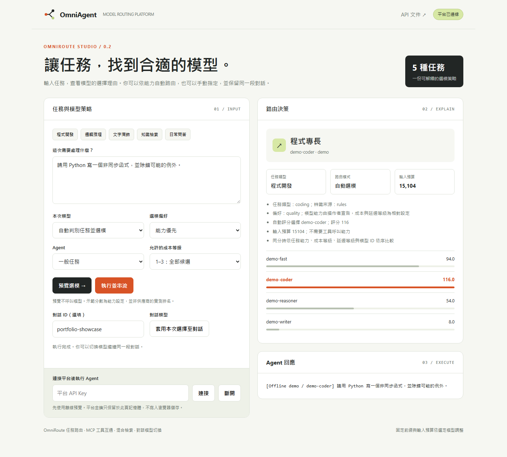

# OmniAgent Platform · OmniRoute

**先辨識任務，再選擇模型。** 將模型切換、可解釋路由、MCP 工具互通、混合檢索與上下文預算，整合成可透過介面、API、CLI 和 MCP 操作的 Agent 平台。



這份作品的設計重點是獨立的 **OmniRoute 策略層**：依任務、能力、成本偏好和上下文限制選模；允許單次指定或整段對話固定模型；切換時保留歷史並重用資料索引。LangChain 擔任執行 adapter，LlamaIndex 提供檢索，平台自行管理選模策略與對話生命週期。

自動選模目前採中英文規則與操作者宣告的能力評分。離線示範使用模擬模型；真實模型品質、價格與 GPU 效能需另外量測。

```powershell
cd agent-platform
uv sync --locked
powershell -ExecutionPolicy Bypass -File .\scripts\start-demo.ps1
```

開啟 `http://127.0.0.1:8000/` 可直接預覽選模。連接腳本產生的本機平台金鑰後，可執行離線 Agent 與串流切換示範。

- [README：快速開始、模型設定與 API／CLI／MCP 用法](agent-platform/README.md)
- [PROJECT_OVERVIEW：架構、個人設計、規劃對照與驗證邊界](agent-platform/PROJECT_OVERVIEW.md)
- [MIT 授權](agent-platform/LICENSE)

主要文件維持兩份，保留三個原始課程範例及一份根目錄 CI。金鑰、環境、快取、備份與建置產物由 `.gitignore` 排除。
