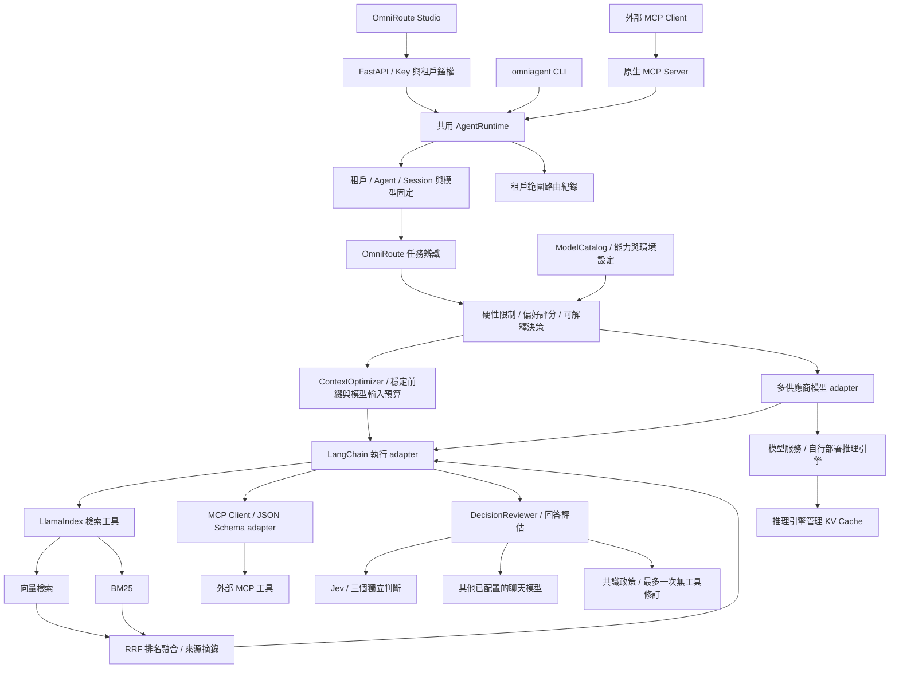

# 架構、個人設計與實作總覽

本文件統整設計依據、原始規劃對照、開發者筆記、驗證與限制。安裝及操作請見 [README](README.md)。

## 定位與個人設計

**OmniAgent 是以 OmniRoute 為控制核心的多模型 Agent 平台。** 任務先經分類與模型政策判斷，選定模型後才準備上下文、建立 LangChain Agent 並執行工具；選用的 DecisionReviewer 再獨立評估回答。路由、評估與資料索引各有邊界，同一份 runtime 服務 API、CLI 與 MCP。

CC Switch 提供多供應商設定管理、切換和本機代理功能，是「切換模型供應商」操作概念的參考。本專案自行實作 Python 模型目錄、任務規則、候選評分與對話政策，未接管 CC Switch 或其他桌面工具的設定檔。[CC Switch 官方說明](https://github.com/farion1231/cc-switch/blob/main/README.md)

LangChain 是成熟的 Agent 編排框架，本身可擴充動態模型。這份作品的原創性應由以下具體決策呈現：獨立於編排框架的模型政策、跨入口的一致行為、切換時的資料與對話生命週期、可審視的選模依據，以及保留證據邊界的作品文件。沒有宣稱提出全新的路由演算法。

| 設計問題 | 我的選擇 | 可審視的實作 |
| --- | --- | --- |
| 如何知道該用哪個模型？ | 先辨識任務、排除不合條件模型，再評分 | `core/model_routing/router.py` |
| 如何切換且保留前文？ | 單次覆寫與持續對話設定分開管理 | `core/orchestrator/runtime.py` |
| 換模型要重新建索引嗎？ | 資料工具按租戶／Agent 快取，執行 Agent 按模型快取 | 同一 runtime 的 `tools`／`agents` |
| 是否可從其他工具使用？ | API、CLI、MCP 共用策略與執行核心 | API 端點、`omniagent`、八個 MCP 工具 |
| 選模能否解釋？ | 回傳任務來源、候選分數、排除原因及執行紀錄 | `RouteDecision`、`routing_traces` |
| 能否照顧推理效率？ | 保持前綴穩定，依模型容量計算歷史預算 | `ContextOptimizer` 與 `input_budget` |
| 回答是否符合使用者要求？ | Jev 與其他模型分開評估三個面向，按政策彙整 | `DecisionReviewer`、`/v1/review`、`agent_review` |

## 整體架構

公開 `/demo/*` 使用獨立示範目錄，與私有 runtime 分離；未連接金鑰也能預覽操作，且不呼叫模型。CLI 是本機操作者入口。MCP 是同一程序的操作者範圍；API 才有多租戶金鑰隔離。

## OmniRoute 如何做決策

### 1. 任務辨識

五類：`general`、`coding`、`reasoning`、`writing`、`knowledge`。中英文關鍵字、程式片段等規則提供訊號；沒有匹配時回到一般任務。只有短追問（例如「繼續」）且當前問題未匹配時，才參考最近使用者問題。呼叫者可用 `task` 明確指定。

決策輸出提供 `source` 與規則 ID，不回傳命中的原始文字。`rule_confidence` 是規則訊號強度，沒有經機率校準；多意圖與沒有關鍵字的任務仍可能誤判。這一版沒有額外呼叫 LLM 分類，讓離線預覽可重現且不產生分類費用。

### 2. 先套用硬性限制

模型必須同時符合：

- 該租戶可見與 Agent 的 `model_ids` 清單。
- profile 啟用，實際模型名稱、必要金鑰與 adapter 已設定。
- Agent 有工具時，模型宣告支援 tool calling。
- `cost_tier` 不超過 Agent 與請求／對話的成本上限。
- 固定前綴和最新問題能放入可用輸入預算。

手動選模仍受同一限制。不存在或不可見的 ID 回傳 404，指定不相容模型回傳 409，固定內容超出預算回傳 413，無其他合格候選回傳 503。`available` 代表本機設定及 SDK 就緒，不代表已探測供應商服務健康或帳戶配額。

### 3. 評分與偏好

`分數 = 任務能力 × 品質權重 − 成本等級 × 成本權重 − 延遲等級 × 延遲權重 − 歷史壓縮懲罰`

| 偏好 | 品質權重 | 成本權重 | 延遲權重 |
| --- | ---: | ---: | ---: |
| balanced | 10 | 6 | 4 |
| quality | 12 | 1 | 1 |
| economy | 6 | 12 | 2 |
| latency | 6 | 2 | 12 |

能力為操作者宣告的 0–10 分，缺少該任務分數時使用一般能力，仍缺少則用 1；成本和延遲是 1–3 的相對等級。歷史超出容量時，壓縮懲罰為超額量除以預算，上限 5。同分依任務能力、成本、延遲與 ID 排序，結果可重現。

這些數值是政策設定，沒有表示真實價格、速度或品質。它們可以讓同一程式任務在 quality 下選專長模型，在 economy 下選通用模型。建立真實選模品質證據，還需要自己的任務資料集與供應商評測。

### 4. 執行與追蹤

API 的 `/v1/route` 與 MCP 的 `route_preview` 只做預覽。真正執行會在取得對話鎖後重新決策，避免預覽後對話被修改導致結果不一致；invoke 回傳實際 route，串流先送實際 route 再送文字。

使用者可指定單次模型，或透過 session 切換固定模型，再恢復自動路由。只在成功後提交完整回合；失敗或取消不提交。系統不在失敗後自動切換供應商重跑，避免重複工具副作用。

近期紀錄最多 512 筆：租戶、Agent、session、decision ID、模型、任務、偏好、狀態、耗時和固定前綴指紋。紀錄不保存問題、回答、金鑰或供應商端點；這是本機排查資料，未取代持久化稽核系統。

## 多來源回答評估

[awesome-jev](https://github.com/yibie/awesome-jev) 提供 Jev 生態參考；本專案直接採 [TypeSafe AI 官方 API](https://docs.typesafe.ai/api) 的 typed `noul` 問題。Jev 對同一份請求與回答分別判斷意圖、完成度和清晰度；另可由模型目錄指定最多兩個不同的聊天模型，各自獨立評分。評估器跳過回答模型及重複底層模型，不把同一份模型輸出計算為多個來源。

每個面向使用示範閾值 `0.75`；至少兩個可用來源且全部通過才標記 `approved`，至少兩個未通過則標記 `needs_revision`，其餘明示 `disagreement`、`single_source` 或 `unavailable`。只有 `needs_revision` 會嘗試一次修訂；修訂直接呼叫原聊天模型，不重新執行 MCP 或檢索工具。只有修訂稿重新達到 `approved` 才採用，對話歷史只提交最終回答。結果包含各來源的分項值、弱項、缺席來源及修訂狀態，路由紀錄只保存狀態。

評估需由呼叫者明確啟用，資料才會傳送至已配置的供應商。同步 `/v1/invoke`、獨立 `/v1/review`、CLI 和 MCP 提供此功能；串流保持原本即時輸出，因此不承諾事後修訂已送出的文字。Jev 問題雖獨立，仍出自同一個模型；其他聊天模型的 0–1 分數也未校準，不能直接解讀為正確率。沒有外部證據的評估無法驗證事實正確性；改善使用者滿意度與減少往返次數仍需真實任務資料量測。

## 模組與生命週期

| 模組 | 責任 |
| --- | --- |
| `core/model_routing/profiles.py` | 驗證模型目錄、租戶可見範圍、設定狀態與公開資訊 |
| `core/model_routing/router.py` | 純政策：任務辨識、輸入容量、限制與候選排序 |
| `core/model_routing/requests.py` | API／MCP／CLI 共用請求驗證與路由參數 |
| `core/model_routing/providers.py` | 延遲載入不同供應商的 LangChain adapter |
| `core/model_routing/cli.py` | 本機模型目錄、預覽及執行命令 |
| `core/orchestrator/runtime.py` | 對話、路由、索引重用、執行與串流生命週期 |
| `core/orchestrator/agent.py` | LangChain 建立 Agent、工具執行與文字串流 |
| `core/decision_review.py` | Jev、獨立模型意見、評估狀態及共識政策 |
| `core/data_engine/` | LlamaIndex 索引、BM25、RRF 與選用摘要 |
| `core/cache_optimizer/` | 固定前綴、輸入估算、歷史壓縮與超限拒絕 |
| `core/demo.py` | 明確啟用的離線聊天與向量 adapter |
| `platform_api/` | API、金鑰管理及 Studio HTML／CSS／JavaScript |
| `mcp_server/` | 原生協議、工具／Resource／Prompt 與外部工具 adapter |

模型 adapter 包含 OpenAI 相容、DashScope，及選用的 Claude／Gemini 原生套件；Claude 與 Gemini 不要求經過 OpenAI 協定轉換。[LangChain ChatAnthropic](https://docs.langchain.com/oss/python/integrations/chat/anthropic)、[ChatGoogleGenerativeAI](https://docs.langchain.com/oss/python/integrations/chat/google_generative_ai)

目錄在啟動時載入。模型名稱與金鑰由環境變數提供，不能從公用 API 任意覆寫端點。部署者修改配置後重啟；使用者切換已載入的模型即時生效。

對話以 `tenant / agent / session` 為範圍，預設最多 256 個、TTL 一小時，成功歷史保留最近 64 回合。同一 session 依鎖序列執行，其他 session 可非同步處理。索引按租戶／Agent 重用，模型 Agent 按租戶／Agent／模型重用。尚未提供跨程序 session、分散式排程或持久化索引。

API bootstrap 金鑰需明確設定；管理金鑰可發行及撤銷 SQLite 中的租戶金鑰。資料庫儲存 SHA-256 摘要，原始金鑰只在發行時回傳。bootstrap 金鑰需透過環境配置移除，無法由管理 API 撤銷。

## Hybrid RAG 與 MCP

資料引擎讀取設定目錄的 UTF-8 `.md`／`.txt`，以 512 token 與 32 token overlap 分塊。向量 retriever 與 BM25 經 LlamaIndex `QueryFusionRetriever` 做 reciprocal rank fusion。

QueryEngine 使用 `NoText` 回傳來源摘錄與檢索分數，由已選定的 Agent 模型產生最後回答。這使檢索不再私下選擇第二個回答模型，也讓聊天模型切換與 embedding 配置分開。未使用 LangChain `RetrievalQA`，未合併兩個框架原始碼。

`AGENT_PLATFORM_TENANT_DOCS` 可指定各租戶資料目錄；一旦啟用租戶映射，未配置的租戶不會退回共用目錄。直接 MCP 檢索採操作者設定的資料路徑，與 API 租戶 Agent 的索引範圍不同。

MCP Python SDK v1 提供 stdio、SSE、Streamable HTTP；八個工具使用共用路由與 runtime，另有 `info://server` 及 `diagnose` 擴充入口。外部 MCP 工具保留 JSON Schema 並加 namespace，API 透過持續存在的連線生命週期使用它們。stdio 的 stdout 只輸出協議，日誌寫入 stderr；網路模式以獨立 `PLATFORM_MCP_KEY` 鑑權。

## KV Cache 感知上下文

固定 System Prompt 與明確設定的 few-shot 保持在最前面，不混入動態 session 資料或摘要。工具依名稱排序，降低 schema 順序變動。模型切換時採同一 Agent 前綴；不同模型服務未必共享 GPU cache，前綴指紋一致也不代表 cache 已命中。

可用輸入預算為 `context_window − max_output_tokens − 協定預留`；有工具預留 1024，無工具預留 256，Agent 可再設定 `max_tokens` 限制。預設使用 UTF-8 byte 數與訊息 framing 做保守估算，可注入 tokenizer；尚未精確計入每個工具 schema、工具結果或後續 Agent 回合。

歷史過長時先保留固定前綴與最新問題，壓縮較舊回合。預設保留摘要首尾並標示 `[omitted]`；可透過 Agent 設定注入 LlamaIndex `SummaryIndex / tree_summarize` 使用的 `summary_llm`。摘要屬可遺失資訊，不稱為無損；目前沒有自動套用某個付費摘要模型。

固定內容本身過長會拒絕，不截斷使用者最新問題。invoke 與 stream 共用準備流程，壓縮在送出模型請求前完成；後端的首字延遲仍受準備與摘要時間影響。

PagedAttention、GPU 記憶體和 KV Cache 由推理引擎管理。本專案實作應用層的前綴與上下文政策，尚未有直接操作 GPU KV Cache 的 adapter。效益需在固定模型、硬體、工作負載及 tokenizer 下量測：

| 基準欄位 | 目前狀態／方法 |
| --- | --- |
| 任務選模正確率／結果品質 | 待建立人工標註資料與跨模型結果評分 |
| 實際費用與失敗率 | 待用供應商 usage／價格及執行紀錄量測 |
| Prefix cache 命中率 | 待接推理引擎實際指標 |
| TTFT p50／p95、tokens/sec | 待固定環境與冷／暖 cache 重複量測 |
| 輸入 token 使用量 | 待使用該模型 tokenizer，包含工具 schema |
| 摘要關鍵資訊保留率 | 待建立含數字、否定與約束的評估案例 |
| GPU 記憶體使用量 | 待由後端量測，無法從應用估算直接推得 |

## 原始四階段規劃對照

| 階段 | 已有實作 | 邊界與後續工作 |
| --- | --- | --- |
| 一：資產與架構 | 保留三個課程範例，建立五層架構與獨立模型策略層 | 原始簡報／筆記內容沒有完整來源，不能補造課程背景 |
| 二：MCP + LlamaIndex | 原生 Server／Client、三種傳輸、QueryEngine 工具、非同步、uv | 已做向量 + BM25；Knowledge Graph／階層檢索尚未實作 |
| 三：上下文與效能 | 穩定前綴、摘要接口、歷史預算、串流共用與超限拒絕 | 沒有無損壓縮保證、每步工具預算、GPU cache 控制或實測效能 |
| 四：作品與發布準備 | Studio、README／總覽、MIT、唯一 CI、乾淨原始碼目錄 | 未推送 GitHub、未執行遠端 Actions、未部署公開服務 |
| 本次追加：模型切換與任務選模 | 模型目錄、供應商 adapter、規則／限制／偏好、對話切換與紀錄 | 未訓練路由模型、未證實任一真實模型是特定任務的最佳選擇 |
| 本次追加：Jev 決策評估 | 多面向 typed 判斷、不同模型意見、共識與一次無工具修訂 | 未以真實 Jev 金鑰驗證準確率，也未實測減少對話往返 |

主要文件維持兩份；根 README 是作品入口。`tests/` 目前有 116 個離線測試（demo 模式，無需金鑰），CI 執行品質、測試、編譯與打包檢查。範例除三個原始課程範例外，`04_mcp_client.py` 與 `05_model_routing.py` 展示 MCP 互聯與模型路由。

## 開發者筆記與範例來源

課程範例提供三個起點：工具型 Agent、模擬網路診斷及對話記憶。從中延伸的個人設計是：將模型選擇提到編排之前，將資料索引與聊天模型解耦，把一次性腳本轉為可經協議操作、可保留狀態且能說明決策的平台。

| 範例 | 保留／新增的目的 |
| --- | --- |
| `01_toolchain_agent.py` | 工具型 Agent 的課程起點 |
| `02_network_diagnosis.py` | 模擬診斷流程與 MCP 工具形式 |
| `03_memory_conversation.py` | 基礎對話記憶及 CLI 互動 |
| `04_mcp_client.py` | 原生 MCP stdio 握手、工具 schema 與檢索調用 |
| `05_model_routing.py` | 五類選模預覽、偏好差異、對話固定與恢復自動路由 |

範例 01–03 透過模型目錄選擇初始模型，保留各自的課程流程；04 以子程序啟動 MCP Server 做真實協議握手，05 直接操作 `ModelRouter` 與 `AgentRuntime` 展示決策依據；逐次任務路由與共用上下文政策由正式 `AgentRuntime`、CLI、API 及 MCP 提供。MCP、LangChain、LlamaIndex、BM25／RRF 的既有概念與實作各有上游來源，個人貢獻是平台組合與政策設計。

## 本機驗證記錄

2026-09-28 在 Windows／Python 3.12 執行，未使用真實付費供應商金鑰：

- 中英文五類任務、成本／品質偏好、短追問、明確任務提示、工具能力、租戶可見範圍與超限拒絕。
- API 預覽、執行、單次覆寫、對話固定／解除、SSE、歷史保留、索引重用、跨租戶紀錄隔離，以及金鑰發行／撤銷。
- 原生 stdio MCP 握手、七個工具、Resource／Prompt、LangChain adapter 與檢索來源；SSE 與 Streamable HTTP 也完成網路握手、鑑權拒絕、選模、對話切換及執行驗證。
- 真正的 ChatOpenAI adapter 連接兩個本機模擬端點，共六次請求；確認自動路由、固定模型、單次覆寫、串流、失敗不跨供應商重試、不提交失敗歷史與不輸出成功終止標記。
- 真實瀏覽器操作離線預覽、連接本機平台、模型固定／恢復、串流回答與窄螢幕排版。
- Ruff 品質／格式、鎖定依賴、套件建置與內容檢查。

2026-09-29 整理程式時，移除兩個驗證腳本及診斷除錯列印，統一三個入口的請求驗證、上下文建立與 SSE 格式，並分離離線 adapter 與網頁資源。再次驗證五類選模、對話歷史、索引重用、租戶隔離、三種 MCP 傳輸、CLI、原始範例及網頁資源；驗證以暫時執行的程式進行，不留下測試檔案或新增報告。

2026-10-08 加入 `DecisionReviewer`：以 TypeSafe Jev 的三個 typed Noul 問題，加上最多兩個不同聊天模型的獨立意見，產生 `approved`、`needs_revision`、`disagreement`、`single_source` 或 `unavailable` 狀態。同步接入 API、CLI、Studio 與第八個 MCP 工具；116 個離線測試通過，未使用真實 Jev 金鑰，因此沒有宣稱真實評估準確率、費用或延遲。

2026-09-29 補齊工程化缺口：恢復 `tests/` 持久化測試套件（112 個測試全部離線、pytest 全綠，覆蓋模型路由、上下文優化、資料引擎、編排層、接入層 API 與 MCP 協議層），並恢復 `04_mcp_client.py`、`05_model_routing.py` 兩個展示範例（均實際運行驗證）；CI 增加 pytest 步驟，`uv.lock` 同步更新。

Claude／Gemini 原生 adapter 依官方介面實作，未在此環境安裝選用 SDK，沒有實際連線驗證。DashScope 與其他真實模型、GPU 效能、公開部署及遠端 CI 結果也未驗證。本機模擬驗證能證明整合流程和供應商請求切換，不能推導真實模型的效果或效能。
