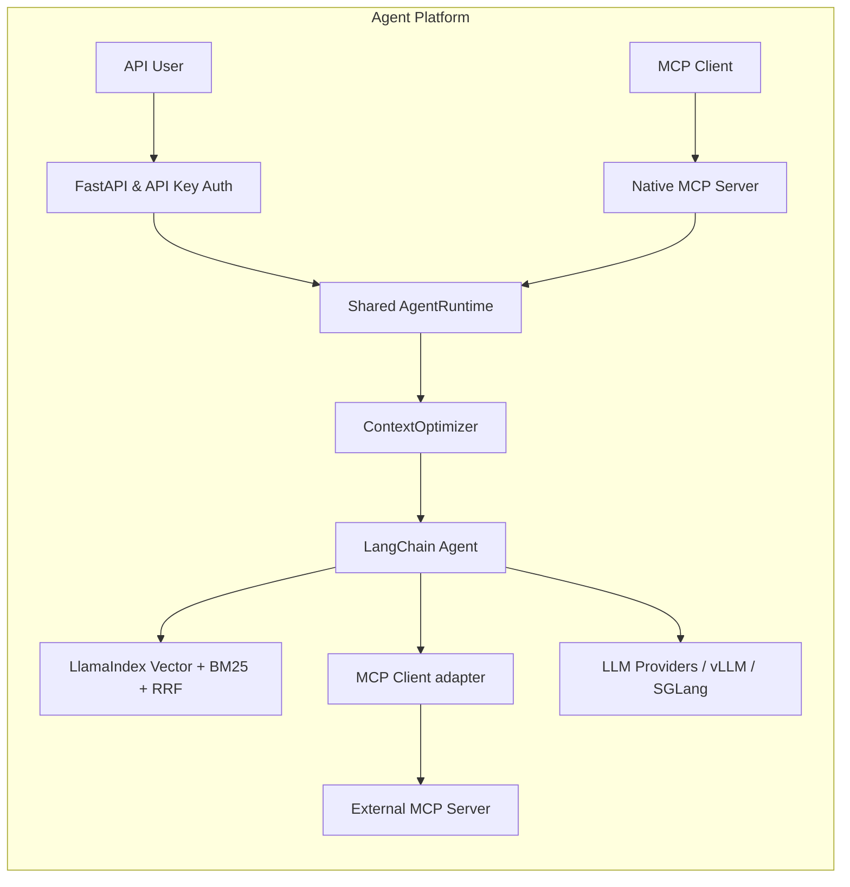

# Agent Platform

**A production-ready, open-source Agent Deployment Platform featuring Native MCP, LangChain Orchestration, LlamaIndex Hybrid Retrieval, and KV-Cache Aware Context Optimization.**

Python 3.11+ · MIT · uv · MCP stdio / SSE / Streamable HTTP

This project provides a robust architecture for deploying LLM agents at scale. It includes built-in API Key management, tenant/agent/session isolation, true text streaming, and native Model Context Protocol (MCP) Server and Client integration.

## Core Value Proposition

Unlike standard LangChain scripts, Agent Platform is designed as a scalable service architecture:

| Feature | Standard Scripts | Agent Platform |
| --- | --- | --- |
| **Entry Point** | Single Python file | FastAPI / OpenAPI with Native MCP |
| **Tool Connection** | In-code `@tool` | Native MCP Server, external MCP Client & LangChain adapter |
| **Retrieval** | Single index | LlamaIndex Vector + BM25 (Hybrid RAG with RRF) |
| **Conversation** | Simple session memory | Isolated by tenant, agent, and session with concurrency locks |
| **Context** | Ever-growing history | Fixed system/few-shot prefix, budget checks, history summarization |

### Architecture Overview



## Quick Start

Execute the following commands in the `agent-platform` directory. Offline mode doesn't require an LLM API Key.

```powershell
uv sync --locked
uv run python -m scripts.smoke
uv run python -m examples.04_mcp_client
```

### Running the API Server

```powershell
powershell -ExecutionPolicy Bypass -File .\scripts\start-demo.ps1
```

The script saves a local random Key in `.state/demo-key.json`. Test the API via PowerShell:

```powershell
$demoKey = (Get-Content -Raw .state/demo-key.json | ConvertFrom-Json).api_key
$body = @{message='What is KV cache?'; agent_id='default'; session_id='demo-session'} | ConvertTo-Json
Invoke-RestMethod 'http://127.0.0.1:8000/v1/invoke' -Method Post -Headers @{'X-API-Key'=$demoKey} -ContentType 'application/json' -Body $body
```

### Native MCP

```powershell
$env:AGENT_PLATFORM_DEMO='1'
uv run python -m mcp_server.server --transport stdio
# For HTTP/SSE:
uv run python -m mcp_server.server --transport streamable-http --port 8001
uv run python -m mcp_server.server --transport sse --port 8002
```

## Performance: KV-Cache Aware Design

Our `ContextOptimizer` fixes prompt prefixes before model generation, compressing old history into the input budget while preserving the latest question. Stable prefixes help inference engines (like vLLM) reuse the same prefix efficiently, maximizing GPU KV Cache hit rates.

```powershell
uv run python -m scripts.benchmark_context
```

## Directory Structure

```text
agent-platform/
├── core/
│   ├── orchestrator/       # Agent and shared runtime
│   ├── data_engine/        # LlamaIndex, BM25, RRF, Summarization
│   └── cache_optimizer/    # Stable prefix & input budgeting
├── platform_api/           # FastAPI, Key Management
├── mcp_server/             # MCP Server, Client, transports
├── examples/               # Usage examples
├── scripts/                # Benchmark and utility scripts
├── docs/                   # Architecture and technical docs
├── tests/                  # Unit and integration tests
└── uv.lock                 # Reproducible dependency lockfile
```

## License

Released under the [MIT License](LICENSE).
