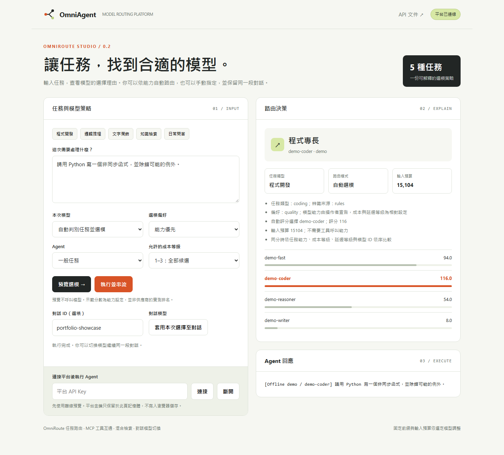
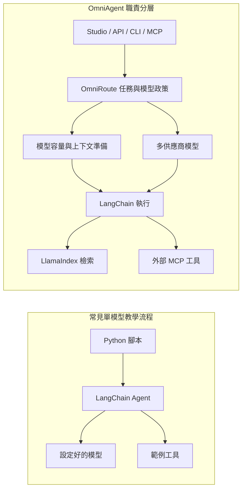

# OmniAgent Platform · OmniRoute

**依任務選模的 MCP Agent 平台：獨立路由策略 × LangChain 執行 × LlamaIndex 混合檢索 × KV Cache 感知上下文管理。**

Python 3.11+ · uv · FastAPI · 原生 MCP Server / Client · MIT



## 作品的核心

OmniRoute 把「這個任務用哪個模型」變成平台中可設定、可預覽、可追蹤的決策。一般對話、程式開發、推理、寫作及知識檢索會依規則辨識；模型能力、工具支援、輸入容量與成本偏好共同決定候選模型。

| 面向 | 使用 LangChain 的典型入門範例 | 本專案的組合設計 |
| --- | --- | --- |
| 模型 | 程式啟動時建立一個模型 | 獨立目錄、多供應商 adapter、逐次任務選模 |
| 切換 | 修改程式或環境設定 | 單次指定、對話固定、恢復自動選模，保留歷史 |
| 決策 | 範例常省略選擇依據 | 預覽任務訊號、候選評分、排除原因與選擇理由 |
| 資料 | 單一 retriever | LlamaIndex 向量 + BM25 + RRF，重用租戶索引 |
| 入口 | Python 腳本 | Studio、API、CLI、七個原生 MCP 工具 |
| 上下文 | 直接累加訊息 | 固定前綴、依模型容量計算預算、壓縮舊歷史 |



LangChain 本身也能實作動態選模；這裡展示的是自己的策略層、生命週期與跨入口整合。設計詳見 [PROJECT_OVERVIEW](PROJECT_OVERVIEW.md)。

## 五分鐘離線啟動

在此目錄執行：

```powershell
uv sync --locked
powershell -ExecutionPolicy Bypass -File .\scripts\start-demo.ps1
```

開啟 `http://127.0.0.1:8000/`：

1. 未連接金鑰即可輸入任務、比較四種偏好與手動選模。
2. 公開預覽使用獨立示範目錄，不呼叫模型，也不建立私人對話。
3. 腳本會將隨機平台金鑰存入 `.state/demo-key.json`。在本機讀取 `api_key`，填入介面即可執行離線 Agent。
4. 執行後可固定對話模型，或選擇「自動判斷任務並選模」後按套用，保留歷史並恢復自動路由。

離線模型會在回答標示 `[Offline demo / 模型ID]`。四個 profile 模擬角色分工，未代表四個真實模型的能力。介面金鑰只留在當頁記憶體，不寫入瀏覽器儲存空間。

其他作業系統可自行設定 `AGENT_PLATFORM_DEMO=1` 和隨機 `PLATFORM_API_KEYS=金鑰:demo`，再執行：

```sh
uv run uvicorn platform_api.api:app --host 127.0.0.1 --port 8000
```

## CLI 與可執行範例

```powershell
$env:AGENT_PLATFORM_DEMO = '1'
uv run omniagent models
uv run omniagent route "請用 Python 寫一個非同步函式" --preference quality
uv run omniagent route "請證明這個數學命題" --max-cost-tier 2
uv run omniagent run "把這封 email 改寫成正式文章" --model demo-writer
uv run python -m examples.01_toolchain_agent
uv run python -m examples.02_network_diagnosis
uv run python -m examples.03_memory_conversation
```

`route` 不呼叫模型；`run` 執行選到的 Agent。`--task` 可明確指定五類任務之一。CLI 為本機操作者入口，每次執行建立新 runtime；跨請求對話使用 API 或持續執行的 MCP Server。

保留的三個範例是原始課程資產；MCP 握手與模型切換的獨立驗證腳本已移除。請透過正式 CLI、API 或 Studio 使用模型路由與對話切換。

## 設定真實模型

```powershell
Copy-Item .env.example .env
Copy-Item models.example.json models.json
```

編輯 `.env`：

```dotenv
AGENT_PLATFORM_DEMO=0
PLATFORM_MODELS_FILE=models.json
PLATFORM_API_KEYS=<自行產生的平台金鑰>:my-tenant
FAST_MODEL=<供應商的實際模型名稱>
FAST_API_KEY=<模型供應商金鑰>
FAST_BASE_URL=<OpenAI相容服務的/v1端點>
CODE_MODEL=<程式模型名稱>
CODE_API_KEY=<供應商金鑰>
CODE_BASE_URL=<程式模型服務的/v1端點>
```

```powershell
uv run --env-file .env uvicorn platform_api.api:app --host 127.0.0.1 --port 8000
```

`models.json` 宣告模型 ID、provider、環境變數名稱、五類能力分數（0–10）、工具支援、上下文容量、輸出上限及成本／延遲等級（1–3）。範例數值是配置示意，請依實際供應商規格與自己的評估修改；未設定完整的模型不會進入候選。

OpenAI 相容介面可配置 Qwen、DeepSeek 或自行部署的相容服務。原生 Claude／Gemini adapter 採選用 SDK：

```powershell
uv add langchain-anthropic langchain-google-genai
```

安裝需要的套件、填入 `CLAUDE_MODEL`／`ANTHROPIC_API_KEY` 或 `GEMINI_MODEL`／`GOOGLE_API_KEY`，並在對應 profile 設定 `enabled: true`。未安裝 adapter 會顯示 `adapter_not_installed`。也保留原有 `DASHSCOPE_API_KEY` 單模型設定。

先使用 `chat` Agent 驗證供應商。若要用 `default` 知識 Agent，另設定 `EMBEDDING_MODEL`、`EMBEDDING_API_KEY`、`EMBEDDING_BASE_URL`；相容舊配置時可沿用 `LLM_API_KEY`／`LLM_BASE_URL`。檢索工具回傳來源摘錄，由當次選定的 Agent 模型回答。切換聊天模型會重用資料索引。

模型目錄在程序啟動時讀取；修改檔案或環境變數後重啟服務。手動切換已載入的模型不需要重啟。`.env` 與 `models.json` 都已排除版本控制。

## API：預覽、執行與固定對話

啟動離線服務後，在另一個 PowerShell 執行：

```powershell
$demoKey = (Get-Content -Raw -Encoding UTF8 .state/demo-key.json | ConvertFrom-Json).api_key
$headers = @{'X-API-Key' = $demoKey}
$body = @{
    message = '請用 Python 寫一個排序函式'
    agent_id = 'chat'
    session_id = 'portfolio-session'
    preference = 'quality'
} | ConvertTo-Json
$bytes = [Text.Encoding]::UTF8.GetBytes($body)
Invoke-RestMethod 'http://127.0.0.1:8000/v1/route' -Method Post -Headers $headers -ContentType 'application/json; charset=utf-8' -Body $bytes
# 同一份 body 改送 /v1/invoke 即可執行並回傳 output 與 route。
```

固定模型：

```powershell
$switch = @{agent_id='chat'; session_id='portfolio-session'; model_id='demo-reasoner'} | ConvertTo-Json
Invoke-RestMethod 'http://127.0.0.1:8000/v1/sessions/model' -Method Post -Headers $headers -ContentType 'application/json' -Body $switch
# 將 model_id 改為 $null 或 'auto'，再呼叫此端點，可保留歷史並恢復自動路由。
```

| 請求中的 `model_id` | 行為 |
| --- | --- |
| 省略或 `null` | 沿用對話固定模型；尚未固定時自動選模 |
| `"auto"` | 本次自動選模，不修改既有對話設定 |
| 實際模型 ID | 本次指定模型，不修改既有對話設定 |

對話的持續設定由 `/v1/sessions/model` 修改；呼叫者不能藉手動指定越過租戶、Agent、工具能力、成本等級或輸入預算限制。

| 端點 | 用途／鑑權 |
| --- | --- |
| `GET /`、`GET /health` | 介面／服務狀態 |
| `GET /demo/models`、`POST /demo/route` | 公開離線預覽 |
| `GET /v1/agents`、`GET /v1/models` | 租戶可見目錄；`X-API-Key` |
| `POST /v1/route` | 預覽決策並取得 session ID；`X-API-Key` |
| `POST /v1/invoke`、`POST /v1/stream` | 執行／SSE；`X-API-Key` |
| `POST /v1/sessions/model` | 固定模型、偏好與成本上限；`X-API-Key` |
| `GET /v1/routing/traces` | 該租戶最近決策；`X-API-Key` |
| `POST /v1/keys`、`GET /v1/keys`、`DELETE /v1/keys/{id}` | 發行／查詢／撤銷；`X-Admin-Key` |

SSE 依序傳送 `session`、`route`、文字 delta 與 `[DONE]`；`route` 是實際執行時的決策。失敗會傳送 `error`，不傳送成功終止標記、不提交歷史。系統不會在工具可能產生副作用後自動換供應商重跑。

## 原生 MCP

```powershell
$env:AGENT_PLATFORM_DEMO = '1'
uv run python -m mcp_server.server --transport stdio
```

七個工具：`ping`、`hybrid_retrieve`、`model_catalog`、`route_preview`、`model_switch`、`agent_invoke`、`routing_traces`。另外提供 `info://server` Resource 與 `diagnose` Prompt。

網路傳輸需設定獨立 `PLATFORM_MCP_KEY`，由 Client 在 `X-API-Key` 傳入：

```powershell
$env:PLATFORM_MCP_KEY = 'mcp_' + [guid]::NewGuid().ToString('N')
uv run python -m mcp_server.server --transport streamable-http --port 8001
# 或：uv run python -m mcp_server.server --transport sse --port 8002
```

端點為 `http://127.0.0.1:8001/mcp` 或 `http://127.0.0.1:8002/sse`。MCP 使用操作者範圍 `mcp-local`，沒有沿用 API 的租戶金鑰制度。API 可透過 `PLATFORM_MCP_SERVERS` 設定外部伺服器；工具 adapter 保留 JSON Schema 與 namespace。Client 的連線與工具轉接實作位於 `mcp_server/client.py`。

## 上下文與部署邊界

固定 System Prompt／明確設定的 few-shot 在前，歷史摘要和最新問題在後；依模型容量扣除輸出額度與協定預留，再壓縮舊歷史。摘要可能遺失資訊，預設保留首尾並標示省略；可注入 LlamaIndex 摘要模型。固定前綴有助後端 prefix caching，但命中率仍取決於供應商。

目前是單一程序的文字 Agent：規則辨識、操作者宣告的相對評分、記憶體對話與路由紀錄。沒有訓練式路由、實時價格最佳化、GPU KV Cache 控制、每個工具回合的 token 硬上限，或已證實的模型品質／效能提升。基準量測欄位與完整規劃對照見 [PROJECT_OVERVIEW](PROJECT_OVERVIEW.md)。

## 精簡目錄與開發

```text
agent-platform/
├── core/
│   ├── model_routing/       # OmniRoute 策略、模型目錄、adapter、CLI
│   ├── orchestrator/        # 共用對話與 LangChain 執行
│   ├── data_engine/         # LlamaIndex 向量 + BM25 + RRF
│   └── cache_optimizer/     # 固定前綴、壓縮與預算
│   # demo.py 僅供明確啟用的離線操作模式
├── platform_api/           # API、金鑰管理、Studio HTML
│   └── static/             # Studio CSS 與 JavaScript
├── mcp_server/             # MCP Server / Client
├── examples/               # 三個課程範例與本機知識資料
├── assets/                 # 介面截圖
├── scripts/start-demo.ps1
├── models.example.json
├── README.md               # 使用說明
├── PROJECT_OVERVIEW.md     # 架構、個人設計、驗證與限制
├── pyproject.toml
└── uv.lock
```

```powershell
uv run ruff check .
uv run ruff format --check .
uv build
```

API、MCP 與 CLI 共用 `core/model_routing/requests.py` 的請求驗證；上下文準備與 SSE 格式也集中處理。離線 adapter 放在 `core/demo.py`，正式供應商及 BM25 檢索不混入模擬實作。

未保留獨立測試套件、驗證腳本或零散報告。唯一 CI 位於儲存庫根目錄 `.github/workflows/agent-platform.yml`，只執行品質檢查、編譯及打包。

授權：[MIT](LICENSE)。
