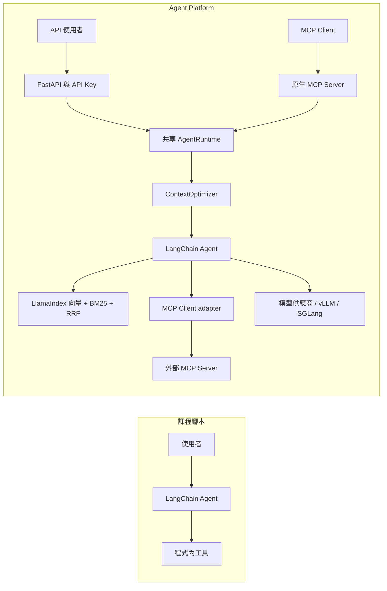

# Agent Platform

**以原生 MCP 連接工具、LangChain 編排 Agent、LlamaIndex 混合檢索及穩定上下文前綴，將課程案例變成可部署的 API 平臺。**

Python 3.11+ · MIT · uv · MCP stdio / SSE / Streamable HTTP

本專案提供可執行的作品集基礎：API Key 管理、租戶／Agent／會話隔離、真正的文字串流、原生 MCP Server 與 Client。離線模式使用明確標示的示範模型與詞彙雜湊向量，先驗證整合，再自行配置模型供應商。它不假裝提供 Kimi 的完整商用能力，也不宣稱能直接控制 GPU KV Cache。

## 與一般課程型 LangChain 腳本的差異

| 面向 | 原本課程腳本 | Agent Platform |
| --- | --- | --- |
| 使用入口 | 執行單一 Python 檔 | FastAPI / OpenAPI 與原生 MCP |
| 工具連接 | 程式內 `@tool` | 同時提供 MCP Server、外部 MCP Client 與 LangChain adapter |
| 檢索 | 案例資料或單一索引 | LlamaIndex 向量 + BM25，使用 RRF 合併排名 |
| 對話 | 依單一 session ID 記憶 | 按 tenant、agent、session 三者隔離，具並行鎖 |
| 上下文 | 歷史持續增加 | 固定 system／few-shot 前綴、預算檢查、歷史摘要 |
| 驗證 | 手動看輸出 | 離線測試、三種 MCP 傳輸測試、實際 HTTP 冒煙測試 |

比較對象是本資料夾的課程腳本；LangChain 本身也能實作上述能力。



## Quick Start：先在本機驗證，再配置模型

下列指令在 `agent-platform` 目錄執行。首次安裝時間依網路而異；離線模式不需要 LLM API Key。

```powershell
cd 'D:\github project\LangChain\agent-platform'
uv sync --locked
uv run python -m scripts.smoke
uv run python -m examples.04_mcp_client
```

第一個範例會自動啟動本機 API、產生臨時平臺 Key、驗證 HTTP 並關閉程序；第二個會啟動原生 stdio MCP，透過 MCP Client adapter 呼叫 LlamaIndex 檢索。

### 保持 API 開啟

```powershell
powershell -ExecutionPolicy Bypass -File .\scripts\start-demo.ps1
```

開啟 [API 文件](http://127.0.0.1:8000/docs)。腳本將本機隨機 Key 存入 `.state/demo-key.json`，不列印 Key。另開 PowerShell：

```powershell
$demoKey = (Get-Content -Raw .state/demo-key.json | ConvertFrom-Json).api_key
$body = @{message='What is KV cache?'; agent_id='default'; session_id='demo-session'} |
  ConvertTo-Json
Invoke-RestMethod 'http://127.0.0.1:8000/v1/invoke' -Method Post `
  -Headers @{'X-API-Key'=$demoKey} -ContentType 'application/json' -Body $body
```

Linux / macOS 使用 `AGENT_PLATFORM_DEMO=1` 及明確的 `PLATFORM_API_KEYS=key:tenant` 環境設定，再啟動 `uv run uvicorn platform_api.api:app --host 127.0.0.1 --port 8000`。不要把實際 Key 寫入 shell 範例或提交至版本控制。

### 原生 MCP

```powershell
$env:AGENT_PLATFORM_DEMO='1'
uv run python -m mcp_server.server --transport stdio
# HTTP 模式另需設定 PLATFORM_MCP_KEY；供應給 Client 的 X-API-Key 必須相符。
uv run python -m mcp_server.server --transport streamable-http --port 8001
uv run python -m mcp_server.server --transport sse --port 8002
```

路徑分別為 `/mcp` 與 `/sse`。MCP 提供 `ping`、`hybrid_retrieve`、`agent_invoke`、`info://server` resource 和 `diagnose` prompt。網路 MCP 是單一操作者範圍；多租戶入口請使用 FastAPI。完整設定見 [MCP 文件](mcp_server/README.md)。

### 切換真實模型

複製 [.env.example](.env.example) 成 `.env`，關閉 `AGENT_PLATFORM_DEMO`，填入 `LLM_API_KEY`、`LLM_BASE_URL`、`LLM_MODEL`、`EMBEDDING_MODEL`，以及平臺 Key。Chat 與 embedding 必須由配置的相容 API 提供。

```powershell
uv run --env-file .env uvicorn platform_api.api:app --host 127.0.0.1 --port 8000
```

模型名稱由操作者指定，沒有寫死某個新模型。沿用課程的 `DASHSCOPE_API_KEY` 也能啟動純聊天 Agent；知識檢索仍需要明確設定 embedding API。實際供應商呼叫尚未使用私人憑證測試。

## API 合約

| 方法與路徑 | 用途 | 憑證 |
| --- | --- | --- |
| `GET /health` | 健康檢查 | 無 |
| `GET /v1/agents` | 可使用的 Agent 列表 | `X-API-Key` |
| `POST /v1/invoke` | 回傳完整答案及 session ID | `X-API-Key` |
| `POST /v1/stream` | SSE session 事件、文字 delta 與 `[DONE]` | `X-API-Key` |
| `POST /v1/keys` | 發行 Key，僅該回應提供原始值 | `X-Admin-Key` |
| `GET /v1/keys` | Key ID、租戶、標籤及撤銷狀態 | `X-Admin-Key` |
| `DELETE /v1/keys/{id}` | 撤銷已管理 Key | `X-Admin-Key` |

invoke / stream JSON：`{"message":"問題","agent_id":"default","session_id":"s1"}`。`message` 是正確欄位；省略 session ID 時由伺服器產生。`default` 使用檢索工具，`chat` 只聊天。

平臺沒有隱含的開發 Key。以 `PLATFORM_API_KEYS` 設定初始 Key，或使用 `PLATFORM_ADMIN_KEY` 管理 SQLite Key 庫。SQLite 只儲存雜湊，不儲存原始 Key；初始環境 Key 的撤銷方式是移除環境設定。

## 效能：已量測與尚未量測

ContextOptimizer 在模型生成前固定前綴，將舊歷史縮入輸入預算，同時保留最新問題。前綴穩定有助於推理引擎重用相同前綴；GPU KV Cache 的配置與實際命中率由後端決定。[vLLM 官方說明](https://docs.vllm.ai/en/latest/features/automatic_prefix_caching/)

```powershell
uv run python -m scripts.benchmark_context
```

| 指標 | 本機結果 | 解讀 |
| --- | --- | --- |
| 範例輸入大小估算 | 29,572 → 1,198；預算 1,200 | UTF-8 文字 byte bound 加訊息開銷，非模型精確 token 數 |
| 固定前綴與最新問題 | 保留 | 可在測試與 JSON 檢查 |
| GPU KV 命中率 | 待實測 | 無 GPU 推理後端數據 |
| TTFT / tokens per second | 待實測 | 不能用離線模型數據推論 |

摘要是有損操作。原始文字保留於有限期的會話記憶，供應商摘要可透過 `summary_llm` 注入 LlamaIndex；未配置時使用明確標示刪節的首尾摘錄。詳見 [KV Cache 文件](docs/kv-cache.md) 與 [量測 JSON](reports/context-benchmark.json)。

## 驗證與 CI

```powershell
uv run ruff check .
uv run ruff format --check .
uv run pytest
uv build
```

測試不需要供應商 Key。MCP 相容性測試以真正的 SDK Client 驗證握手、tools、resources、prompts、檢索及 Agent 呼叫；HTTP 冒煙測試會啟動真正的 Uvicorn。CI 覆蓋 Windows / Linux 與 Python 3.11 / 3.12 / 3.13，並產生 JUnit 與建置產物。

若發布整個 LangChain 目錄，使用父層 `.github/workflows/agent-platform.yml`；若將 `agent-platform` 作為獨立 repository，使用其內的 `.github/workflows/ci.yml`。

## 目錄

```text
agent-platform/
├── core/
│   ├── orchestrator/       # Agent、共享 runtime、教學記憶範例
│   ├── data_engine/        # LlamaIndex、BM25、RRF、摘要
│   └── cache_optimizer/    # 穩定前綴與輸入預算
├── platform_api/           # FastAPI、Key 管理；避開 stdlib platform 衝突
├── mcp_server/             # Server、Client、transport 與 tool adapters
├── examples/knowledge/    # 自撰示範知識庫
├── scripts/                # 本機啟動、HTTP 冒煙、上下文量測
├── docs/                   # 架構、資產盤點、開發者筆記
├── reports/                # 驗證證據
├── tests/                  # 單元與整合測試
├── TASKS.md                # 四階段驗收表
└── uv.lock                 # 可重現的依賴鎖定
```

## 開發者筆記與部署邊界

課程提供工具鏈、模擬網路診斷、對話記憶與 LCEL 的出發點；MCP 雙向連接、混合檢索、租戶隔離、Key 管理與上下文預算則是本作品集的整合設計。來源與個人延伸分開記錄於 [開發者筆記](docs/developer-notes.md)、[資產盤點](docs/asset-audit.md) 與 [任務驗收表](TASKS.md)。

這是單程序平臺基礎：會話最多 256 個、閒置一小時清理、保留最近 64 輪，重新啟動後會話清空。Key 以 SQLite 持久化。私有知識庫需配置 `AGENT_PLATFORM_TENANT_DOCS`；外部 MCP 工具由操作者選定且視為該 API 的共享能力。公開服務前需另接 TLS、限流、配額、持久會話與組織權限，不能直接視為商用多租戶產品。

## License

新增平臺程式以 [MIT](LICENSE) 發布。原始課程素材的權利與授權另行確認；本套件不包含完整課程 PDF 或其全文轉錄。
