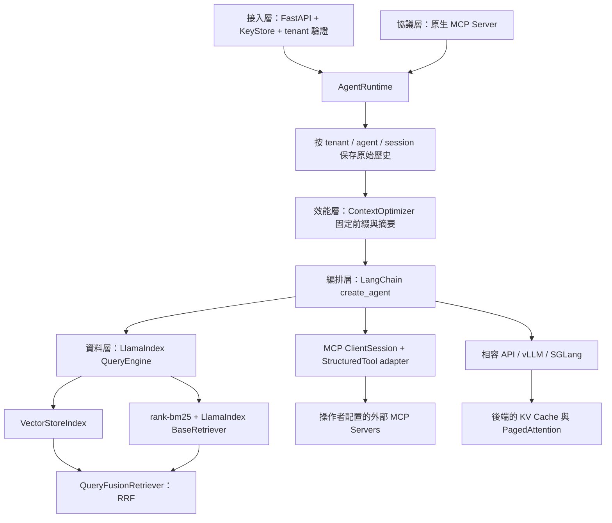

# 架構與技術選型

## 分層責任

`platform_api` 驗證平臺 Key、取得租戶、限制輸入格式、傳送 SSE 與管理 Key。它的名稱特別避開 Python 標準函式庫 `platform`；沒有覆寫 `sys.modules` 的特殊啟動方式。

`core/orchestrator` 使用 LangChain `create_agent` 產生有工具迴圈的 graph，排序工具名稱以穩定 schema 排列。固定 system 訊息只由 ContextOptimizer 注入一次。編排層不使用 RetrievalQA，也不建立索引。[LangChain 官方介面](https://reference.langchain.com/python/langchain/agents/factory/create_agent)

`core/data_engine` 載入 UTF-8 `.md` / `.txt`，切塊後建立 LlamaIndex VectorStoreIndex 與 BM25 Retriever，使用 QueryFusionRetriever 的 reciprocal rank fusion 合併。`num_queries=1` 避免偷偷呼叫 query-expansion 模型；資料由 LlamaIndex 管理，回答包含檔名、摘錄與分數。[LlamaIndex 官方 RRF 範例](https://developers.llamaindex.ai/python/framework/integrations/retrievers/reciprocal_rerank_fusion/)

`mcp_server` 提供官方 SDK FastMCP Server、stdio / SSE / Streamable HTTP ClientSession，以及保留 JSON inputSchema 的 LangChain StructuredTool adapter。SDK 鎖定 `mcp>=1.28,<2`，避免依賴解析升級後不相容；這是明確維護 v1 API 的選擇。[SDK v1 官方文件](https://github.com/modelcontextprotocol/python-sdk/tree/v1.x)

`core/cache_optimizer` 在 invoke 和 stream 開始前處理完成的對話輪次，不在串流中途修改上下文，不改寫工具呼叫 ID。超長最新問題回報 `ContextBudgetError`，API 轉成 413。

## 隔離、狀態與失敗處理

租戶身分從驗證後的 Key 推導，請求 JSON 不能指定 tenant。會話 key 是 `(tenant_id, agent_id, session_id)`；同一會話用 asyncio.Lock 序列化，並只在完整成功的回覆後寫入歷史。中途取消不保存部分答案。

設定 `AGENT_PLATFORM_TENANT_DOCS` 私有目錄映射後，未配置的租戶無法回退到公共資料。索引與 Agent 依租戶分開建立。MCP 檢索工具只接受 query，客戶端不能指定任意本機目錄。外部 MCP 設定來自服務環境，不能由未信任的 request 指定程序或 URL。

API 以 401 拒絕缺失／錯誤 Key、404 拒絕不存在／無權使用的 Agent、413 拒絕不能保留最新問題的預算、503 表示服務配置／模型／索引不可用。串流已送出 headers 後的失敗改成 `event: error`，不發送成功 `[DONE]`。回應不直接輸出供應商 exception，伺服器 log 只記錄 exception 類別。

KeyStore 的發行、列表與撤銷由獨立 `X-Admin-Key` 保護，原始 Key 只在發行回應出現；SQLite 儲存 SHA-256 digest。bootstrap 環境 Key 不屬於 SQLite 發行清單。

## 部署選擇

目前是模組化單體，適合本機示範與小型部署。資料檔修改後須重啟以重建索引；沒有背景 ingestion。LlamaIndex 可日後改成獨立服務，協議合約仍維持 query 工具。

MCP 網路入口需 `PLATFORM_MCP_KEY`，屬於單一操作者的資料／工具範圍；不是根據這個 Key 自動建立租戶。stdio 使用本機程序權限。SSE 保留相容性；新連線可使用 Streamable HTTP。

會話存於程序記憶，具 TTL、容量與輪數界限；Key 使用 SQLite。多 worker / 機器部署需要共享會話儲存與分散式鎖。檢索與摘要應使用模型相應的 tokenizer；目前預算的預設 byte 估算只用於應用端保守限制。
